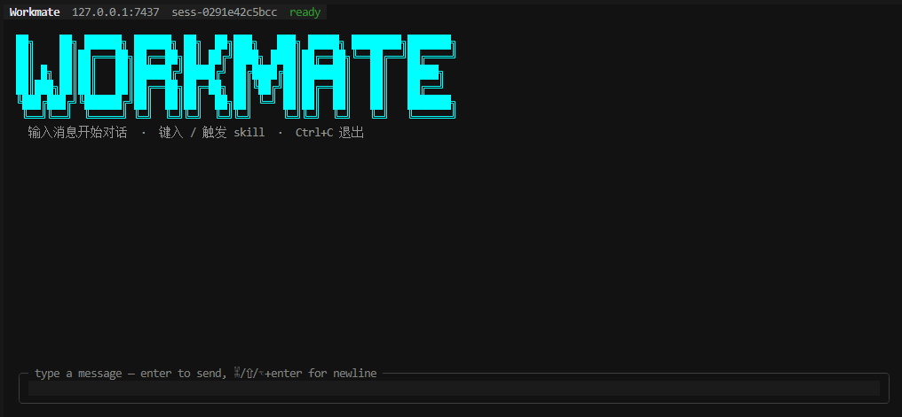
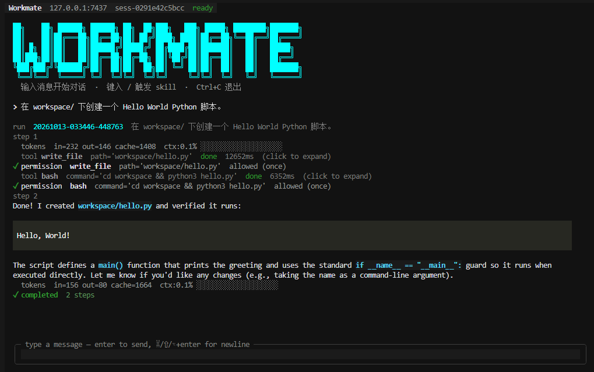

# Workmate

Workmate 是一个基于 Python 的终端 AI Agent，可以通过自然语言完成代码阅读、文件编辑、Shell 命令执行等任务。项目采用 Core 后端与 TUI 终端界面分离的方式运行，支持多轮对话、工具权限审批、上下文压缩、子 Agent 和 MCP 扩展。



## 环境要求

- Python 3.12
- uv（Python 项目与依赖管理工具）
- Anthropic API 密钥，或兼容 Anthropic Messages API 的服务

## 安装与配置

下载或克隆本仓库后，进入项目目录并安装依赖：

```bash
cd Workmate
uv sync --frozen
```

首次使用时，复制环境配置模板。已有 `.env` 时，下面的命令会保留原文件：

```bash
cp -n .env.example .env
```

编辑 `.env`，填写密钥和模型名称：

```dotenv
ANTHROPIC_API_KEY=your_api_key
WORKMATE_LLM_DEFAULT_MODEL=your_model
```

如果使用兼容 Anthropic Messages API 的服务，还需要设置服务商提供的地址，并将模型名称改为该服务支持的模型 ID：

```dotenv
ANTHROPIC_BASE_URL=https://your-provider.example
```

`.env` 用于保存本地配置和密钥，不要提交到 Git 仓库。修改配置后，重启 Core 生效。

## 启动

打开两个终端，均进入 Workmate 项目根目录，按顺序执行以下命令。

**终端一：启动 Core 后端，并保持运行。**

```bash
uv run workmate-core
```

**终端二：启动 TUI 交互界面。**

```bash
uv run workmate-tui
```

默认连接地址为 `127.0.0.1:7437`。界面显示 `ready` 后即可开始使用。需要调整地址时，在 `.env` 中设置 `WORKMATE_HOST` 和 `WORKMATE_PORT`。

## 使用

在输入框中描述你的任务，按 `Enter` 发送，例如：

```text
帮我梳理当前项目的目录结构，说明各模块的作用。
```

```text
在 workspace/ 下创建一个 Hello World Python 脚本。
```



界面会实时显示模型回复、工具调用和执行结果。任务完成后，可以继续输入消息追问或安排下一步任务。

需要权限审批时，使用方向键选择允许或拒绝，再按 `Enter` 确认；也可以按 `y` 允许本次操作，或按 `n` 拒绝本次操作。

| 操作 | 按键或命令 |
| --- | --- |
| 发送消息 | `Enter` |
| 输入框内换行 | `Ctrl+J` |
| 手动压缩当前会话上下文 | 输入 `/compact` 并发送 |
| 退出 TUI | `Ctrl+Q` |

输入 `/` 可以查看内置技能提示，例如 `/review` 用于代码审查。退出 TUI 后，在终端一按 `Ctrl+C` 停止 Core。

如果界面无法连接，先确认 Core 已启动，并在项目目录执行以下命令检查连通性：

```bash
uv run workmate ping
```

更多运行与开发说明见 [RUNBOOK.md](RUNBOOK.md)。

## 许可证

本项目采用 [MIT 许可证](LICENSE)。
